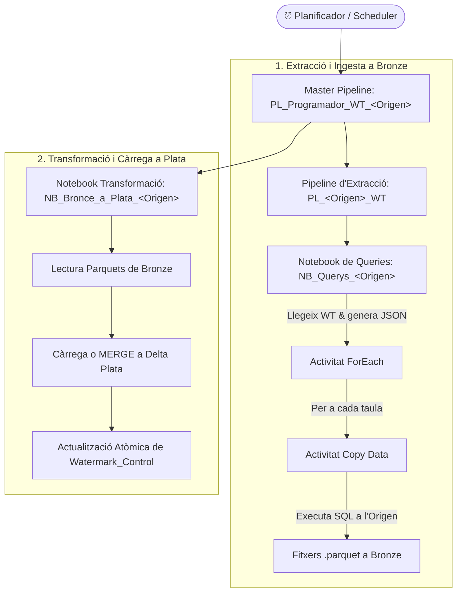
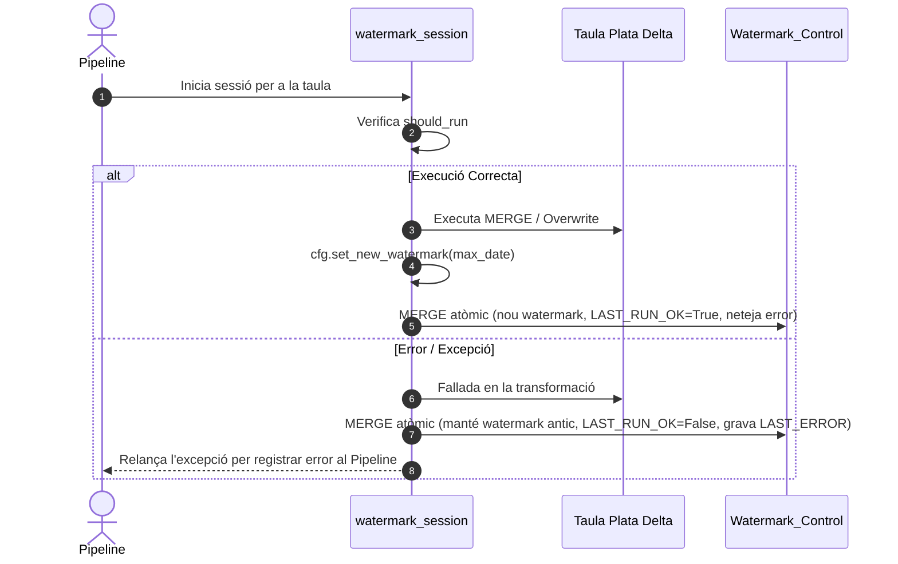

# Arquitectura del Sistema

L'orquestració de dades amb `bfg_watermark` s'estructura en **dos nivells de Data Pipelines** i **un conjunt coordinat de Notebooks de Microsoft Fabric**, tots governats per la taula `Watermark_Control`.

---

## Visió General del Flux



---

## Els Tres Passos d'Execució

### Pas 1: El Notebook de Queries (`NB_Querys_<Origen>`)

És el primer component que s'executa quan el Pipeline Mestre arrenca. La seva funció és consultar la `Watermark_Control` per al sistema corresponent i generar la llista de queries SQL preparades per enviar a l'activitat *Copy Data*:

```python
import bfg_watermark as wm
import json

# Obtenir només les taules executables ordenades
configs = wm.WatermarkQuery(spark).source("SAGE").runnable().ordered().build()

# Construir el JSON de sortida per al Pipeline
output = [
    {
        "table": cfg.table_name,
        "query": cfg.build_source_query(),
        "bronze_path": cfg.bronze_path
    }
    for cfg in configs
    if cfg.build_source_query() is not None
]

# Sortir del notebook retornant el JSON a Fabric
mssparkutils.notebook.exit(json.dumps(output))
```

!!! tip "Separació de responsabilitats"
    L'activitat de còpia del Pipeline **no necessita conèixer dates de tall ni filtres incrementals**. Tota aquesta lògica està encapsulada a `cfg.build_source_query()`, que afegeix el filtre `>= <from_date>` i la subquery `EXISTS` en cas de ser necessari.

---

### Pas 2: El Pipeline d'Extracció (`PL_<Origen>_WT`)

1. Rep el JSON retornat pel Notebook de Queries.
2. Itera mitjançant un bucle `ForEach` sobre cada taula.
3. Per a cada element, una activitat **Copy Data** executa el text SQL contra la connexió ODBC / Linked Service de la base de dades origen.
4. Escriu el resultat com a fitxer `.parquet` a la ubicació especificada a `BRONZE_PATH` del Lakehouse.

---

### Pas 3: El Notebook de Transformació (`NB_Bronce_a_Plata_<Origen>`)

Un cop finalitzada l'extracció a Bronze, el Pipeline Mestre crida el Notebook de transformació Silver. Per a cada taula:

1. Obté la configuració actualitzada mitjançant `WatermarkQuery`.
2. Executa el bloc de codi dins del context manager `with watermark_session(...)`.
3. Llegeix el fitxer parquet de Bronze.
4. Si el mode és `FULL_RELOAD`: sobreescriu la taula Delta Plata (`mode("overwrite")`).
5. Si el mode és `INCREMENTAL`: executa un `MERGE` atòmic emprant les claus primàries definides a `cfg.pk_columns`.
6. Calcula la data màxima del lot amb `cfg.set_new_watermark(max_date)`.
7. En sortir del context manager, la sessió s'encarrega d'executar un únic `MERGE` atòmic contra `Watermark_Control` per registrar l'èxit i el nou watermark.

---

## Gestió d'Errors i Resiliència


