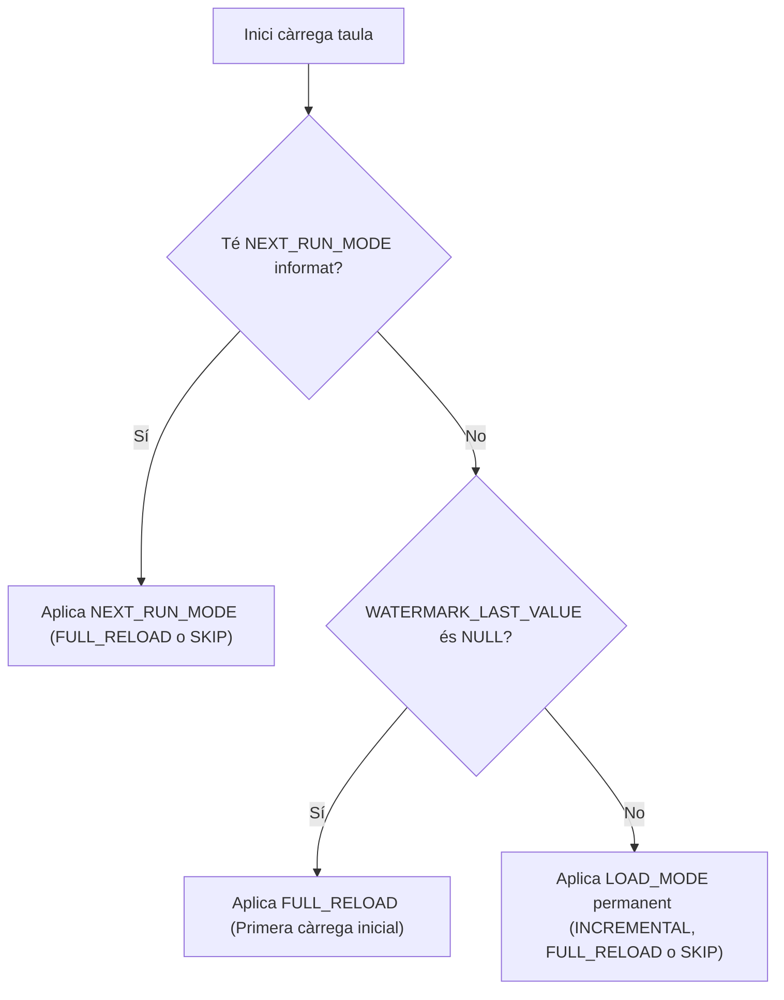

# La Taula de Control: `Watermark_Control`

La taula Delta **`Watermark_Control`** és el centre neuràlgic de tot el sistema de càrregues. Viu al Lakehouse **`LH_BRONCE_PLATA`** i conté tant la configuració estàtica de cada taula (com es diu a l'origen, on s'escriu a Bronze i Plata, quines columnes formen la PK) com el seu estat dinàmic (últim watermark guardat, resultat de la darrera execució, incidències i modes efectius).

La taula consta de **21 columnes físiques**, organitzades en 5 grups funcionals i governades per l'esquema de metadades [`schema.CONTROL_TABLE_SCHEMA`](api/schema.md).

---

## 1. Columnes d'Identitat

Identifiquen de forma unívoca cada registre. La clau primària lògica és la combinació **`(SOURCE + TABLE_NAME)`**.

| Columna | Tipus | Exemple | Descripció | Requerida |
|:---|:---|:---|:---|:---:|
| `SOURCE` | `STRING` | `'SAGE'` | Identificador del sistema d'origen des del qual es carrega la taula (ex: `'SAGE'`, `'ORACLE'`, `'SAP'`). Agrupa totes les taules d'un mateix proveïdor de dades. S'usa com a criteri principal a Pipelines i a `WatermarkQuery.source(...)`. | **Sí** |
| `TABLE_NAME` | `STRING` | `'PORDER'` | Nom exacte de la taula a la base de dades font. **No és el nom a Plata**, sinó el de l'objecte origen. Forma la PK amb `SOURCE`. | **Sí** |
| `AREA` | `STRING` | `'COMPRES'` | Àrea funcional o domini de negoci (ex: `'COMPRES'`, `'VENDES'`, `'STOCKS'`). Permet activar, desactivar o modificar blocs complets de taules amb una sola comanda. | **Sí** |
| `IS_DIMENSION` | `BOOLEAN` | `false` | Indica si la taula és una dimensió (`true`) o de fets (`false`). Les dimensions petites se solen carregar completes cada vegada (`FULL_RELOAD`) sense lògica incremental. Per defecte: `false`. | No |

---

## 2. Columnes d'Enrutament

Indiquen exactament on s'han de dipositar els fitxers intermedis a Bronze i quina taula Delta final s'ha d'alimentar a Plata.

| Columna | Tipus | Exemple | Descripció | Requerida |
|:---|:---|:---|:---|:---:|
| `SILVER_TABLE` | `STRING` | `'silver_sage_compres_porder'` | Nom complet de la taula Delta destí a la capa Silver. El notebook hi escriu el resultat final mitjançant `saveAsTable()` o `DeltaTable.forName()`. | **Sí** |
| `BRONZE_PATH` | `STRING` | `'Files/Bronze/Sage/Compres/PORDER.parquet'` | Ruta relativa des de l'arrel del Lakehouse on l'activitat *Copy Data* del Pipeline desa el fitxer `.parquet`. El notebook Bronze→Plata llegeix directament d'aquesta ruta. | **Sí** |

---

## 3. Columnes d'Extracció i Merge

Controlen la construcció de la query SQL contra la base de dades origen i la condició de creuament (Upsert / MERGE) a Plata.

| Columna | Tipus | Exemple | Descripció | Requerida |
|:---|:---|:---|:---|:---:|
| `SOURCE_QUERY` | `STRING` | `'SELECT UPDTICK_0, NUM_0, UPDDATTIM_0 FROM porder'` | Query SQL base (sense filtre temporal). `cfg.build_source_query()` agafa aquest SQL i, si el mode és incremental, hi afegeix automàticament el filtre `>= <from_date>` i una subquery `EXISTS`. Si és `NULL`, el notebook gestiona la query de forma personalitzada. | **Sí** |
| `SOURCE_DATECOL` | `STRING` | `'UPDDATTIM_0'` | Columna de timestamp a l'origen que s'empra per al filtrat incremental (data de modificació o creació). | **Sí** |
| `SOURCE_DATECOL_FORMAT` | `STRING` | `'%Y-%m-%d %H:%M:%S'` | Format Python (`strftime`) per formatar el valor temporal al text de la query SQL. Per defecte: `'%Y-%m-%d %H:%M:%S'`. | **Sí** (amb defecte) |
| `WINDOW_DAYS` | `INTEGER` | `2` | Dies de solapament temporal de seguretat (lookback window). Resta aquest nombre de dies al watermark per cobrir transaccions obertes o desfasaments de rellotge. Per defecte: `0`. | No |
| `PK_COLUMNS` | `STRING` (JSON) | `'["NUM_0", "CPY_0"]'` | Llista JSON amb els noms de les columnes que formen la clau primària a Plata. S'utilitza per construir la condició `target.k = source.k` al MERGE. | **Sí** |

---

## 4. Columnes de Control d'Execució

Determinen si la taula s'ha d'executar i quina estratègia s'ha d'adoptar en cada cicle.

| Columna | Tipus | Valors Vàlids | Descripció | Requerida |
|:---|:---|:---|:---|:---:|
| `ACTIVE` | `BOOLEAN` | `true`, `false` | Habilita o inhabilita la taula. Les taules amb `ACTIVE = false` són automàticament ignorades per `.runnable()` i `.active_only()`. Per defecte: `true`. | No |
| `LOAD_MODE` | `STRING` | `INCREMENTAL`, `FULL_RELOAD`, `SKIP` | **Mode permanent:** Defineix el comportament habitual en cada cicle. `INCREMENTAL` (només novetats), `FULL_RELOAD` (tot de zero), `SKIP` (omissió). Per defecte: `INCREMENTAL`. | No |
| `NEXT_RUN_MODE` | `STRING` \| `NULL` | `FULL_RELOAD`, `SKIP`, `NULL` | **Override puntual:** Sobreescriu el `LOAD_MODE` una única vegada. La sessió el neteja automàticament a `NULL` en acabar amb èxit. Per defecte: `NULL`. | No |
| `RUN_ORDER` | `INTEGER` | `1`, `2`, `3`... | Prioritat o seqüència d'execució. Les taules amb número més baix s'executen primer amb `.ordered()`. Per defecte: `1`. | No |

### Lògica de prioritat del mode efectiu (`effective_mode`)

El codi del Notebook **mai no ha de llegir `LOAD_MODE` directament**, sinó utilitzar la propietat calculada `cfg.effective_mode`, que resol la prioritat de la següent forma:

---

## 5. Columnes d'Estat i Auditoria

Són escrites i mantingudes de forma automàtica per la llibreria (`watermark_session` i `WatermarkAdmin`).

!!! warning "Protecció de columnes de sistema"
    Per evitar trencar la integritat i traçabilitat del sistema, el mòdul de validació rebutja canvis manuals directes sobre les columnes d'auditoria `CREATED_AT` i `UPDATED_AT`.

| Columna | Tipus | Descripció |
|:---|:---|:---|
| `WATERMARK_LAST_VALUE` | `TIMESTAMP` | Marca temporal de l'últim registre processat amb èxit. Si és `NULL`, el sistema sap que la taula no s'ha carregat mai i forçarà `FULL_RELOAD`. |
| `LAST_RUN_AT` | `TIMESTAMP` | Data i hora exacta en què va finalitzar l'última execució (exitosa o amb error). |
| `LAST_RUN_OK` | `BOOLEAN` | `true` si la darrera execució es va completar sense incidències; `false` si es va produir una excepció. |
| `LAST_ERROR` | `STRING` | Missatge truncat a 500 caràcters de l'última fallada. Es neteja automàticament a `NULL` quan l'execució següent és exitosa. |
| `CREATED_AT` | `TIMESTAMP` | Timestamp de creació de la fila a la taula de control (`CURRENT_TIMESTAMP()`). |
| `UPDATED_AT` | `TIMESTAMP` | Timestamp de l'última actualització del registre, tant per cicle de Pipeline com per operació manual d'administració. |

---

## 6. Esquema Centralitzat i Suport per a Columnes Extres

Des de la versió **1.0.6**, la definició de l'esquema resideix a [`bfg_watermark.schema.CONTROL_TABLE_SCHEMA`](api/schema.md):

1. **Validació automàtica:** Les cadenes de text es netegen amb `.strip()`, les llistes de claus primàries es converteixen automàticament a JSON i es verifica que els tipus Python coincideixin estrictament.
2. **Columnes personalitzades (`**extra_fields`):** La taula de control Delta admet afegir columnes suplementàries (com `ENVIRONMENT`, `TAGS`, `RESPONSIBLE`). Aquests camps es poden inserir mitjançant `admin.insert_table(**extra_fields)`, actualitzar mitjançant `admin.update_table(**kwargs)`, filtrar amb `WatermarkQuery.where(col=val)` i consultar directament amb `cfg.get('nom_columna')` o per atribut `cfg.nom_columna`.
