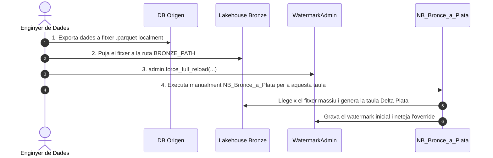

# Escenaris Especials

Aquesta secció detalla com actuar en situacions excepcionals que requereixen un tractament diferenciat del flux automàtic habitual.

---

## 1. Càrrega Inicial Massiva (Històrics Grans)

### El Problema
Quan s'incorpora una taula nova que conté desenes de milions de registres o centenars de gigabytes a la base de dades origen (ex: Sage, SAP, Oracle), deixar que l'activitat *Copy Data* del Pipeline orquestrador l'extregui pot provocar:
- Esgotament de la capacitat de còmput (Capacity Units - CUs) a Microsoft Fabric.
- Bloquejos prolongats o timeout a la base de dades font.
- Caiguda de tot el Pipeline nocturn.

### La Solució Recomanada

Segueix aquest procediment de 4 passos per carregar l'històric massiu de manera aïllada i segura:



#### Passos detallats:

1. **Extracció Manual Fora d'Hores:**
   Des del teu client de base de dades (DBeaver, SQL Server Management Studio, etc.), exporta totes les dades de la taula a un fitxer `.parquet`.
2. **Pujada a Bronze:**
   Ves a l'explorador de fitxers de Microsoft Fabric al Lakehouse `LH_BRONCE_PLATA` i puja el `.parquet` exactament a la ubicació que figura a la columna `BRONZE_PATH` de la taula de control.
3. **Verificació de Mode:**
   Assegura't que la taula estigui en mode de recàrrega completa puntual:
   ```python
   admin = WatermarkAdmin(spark)
   admin.force_full_reload(source="SAGE", table="PORDER")
   ```
4. **Execució Manual Aïllada del Notebook de Transformació:**
   Obre el notebook `NB_Bronce_a_Plata_<Origen>` a Fabric i executa només la cel·la per a aquesta taula (sense engegar el Pipeline Mestre).
   - El Notebook detectarà el mode `FULL_RELOAD`, carregarà el gran volum de dades i generarà la taula Plata Delta.
   - En acabar amb èxit, la sessió avançarà el watermark al darrer valor trobat i netejarà `NEXT_RUN_MODE`.
   - A partir de la propera nit, el Pipeline ja funcionarà en mode `INCREMENTAL` de forma completament desatesa.

---

## 2. Omissió Selectiva (Incidència a l'Origen)

Si un conjunt de taules específic té problemes a l'origen però vols que la resta del Pipeline nocturn s'executi amb normalitat:

```python
admin = WatermarkAdmin(spark)

# Bloquejar les taules conflictives
admin.skip_next_run(source="SAGE", table="SINVOICE")
admin.skip_next_run(source="SAGE", table="SINVOICED")

# Ara pots llançar el Pipeline: processarà totes les taules tret d'aquestes dues.
```

Quan l'origen estigui corregit, desbloqueja-les:
```python
admin.resume_from_skip(source="SAGE", table="SINVOICE")
admin.resume_from_skip(source="SAGE", table="SINVOICED")
```

---

## 3. Recuperació davant de Corrupció amb Delta Time Travel

Si algú ha modificat per error la taula `Watermark_Control` (ex: s'han eliminat registres o s'han sobreescrit watermarks indegudament), pots aprofitar l'historial transaccional de Delta Lake per recuperar-la.

### Pas 1: Consultar l'Historial de Versions
```python
admin = WatermarkAdmin(spark)
display(admin.show_history(limit=20))
```
Localitza el número de versió (`version`) o la data/hora (`timestamp`) en què la taula estava en bon estat.

### Pas 2: Inspeccionar la Taula en el Passat (Sense Modificar-la)
```python
# Inspeccionar la versió 4 en mode només lectura
display(admin.inspect_table(version=4))

# O per timestamp:
display(admin.inspect_table(timestamp="2026-01-15 07:00:00"))
```

### Pas 3: Restaurar l'Estat (Acció Destructiva / Undo Total)
Un cop comprovat que la versió seleccionada és la correcta, executa el mètode `recover_table()`:

```python
admin.recover_table(version=4)
# O bé:
admin.recover_table(timestamp="2026-01-15 07:00:00")
```

Aquesta operació fa un `RESTORE TABLE` que retrocedeix la taula `Watermark_Control` a l'estat anterior de forma immediata i atòmica.
